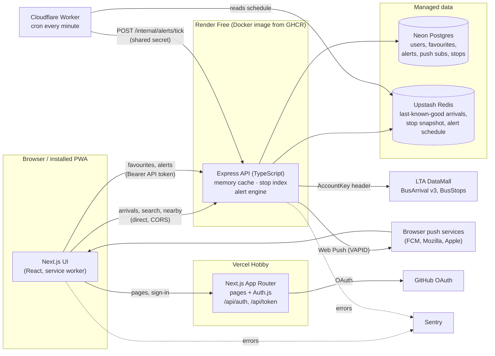
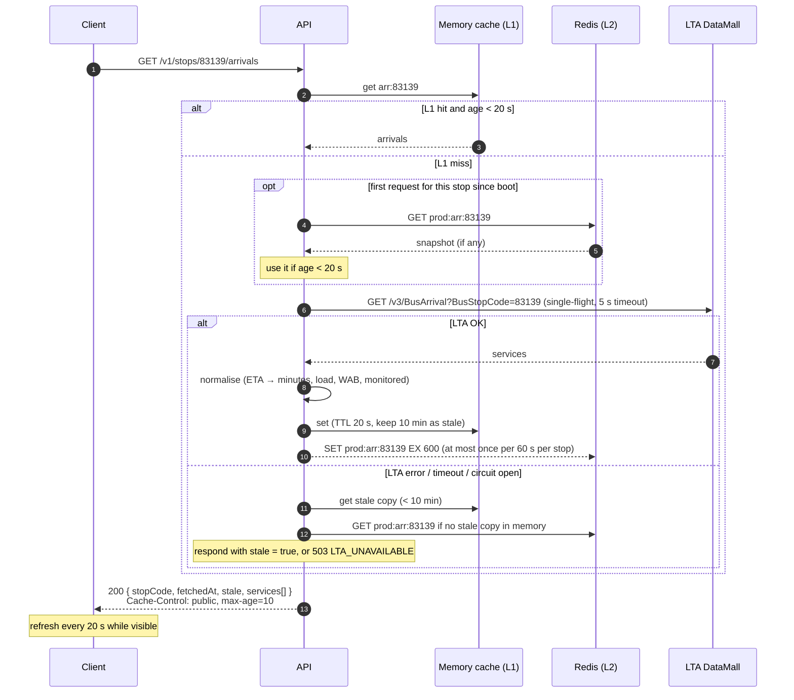
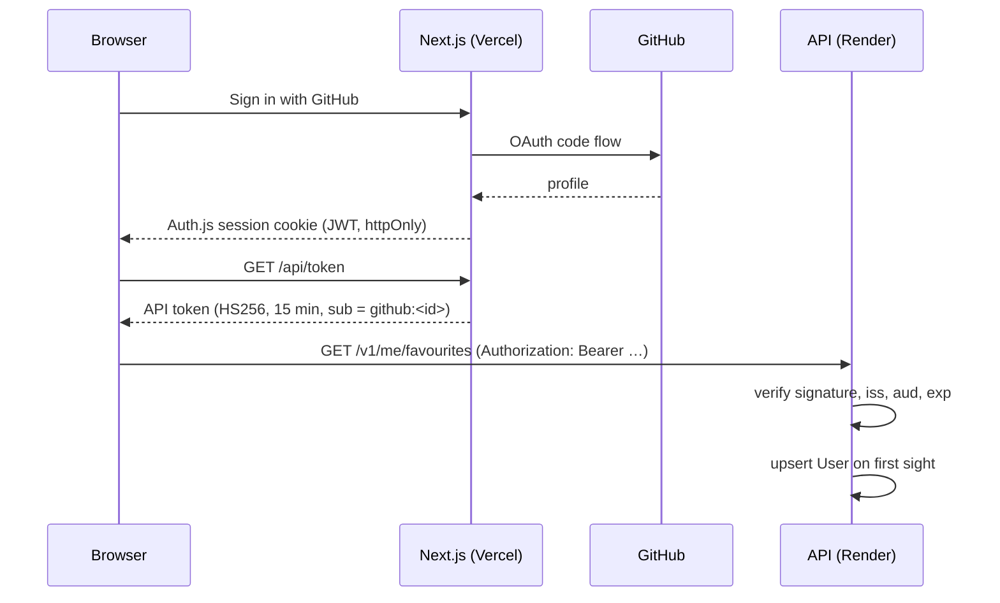

# Architecture

This document describes how SG Transit Companion is put together and why. The decisions behind it are recorded as ADRs in [`adr/`](adr/). Free-tier limits referenced here are in [COSTS.md](COSTS.md).

## 1. System overview



### Components

| Component            | Runs on               | Responsibility                                                                                                                                                                                         |
| -------------------- | --------------------- | ------------------------------------------------------------------------------------------------------------------------------------------------------------------------------------------------------ |
| **Web** (`apps/web`) | Vercel                | Next.js App Router UI, service worker and manifest, Auth.js (GitHub OAuth, JWT sessions), `/api/token` route that exchanges the session for a short-lived API token. Holds **no** database connection. |
| **API** (`apps/api`) | Render (Docker)       | All data access: LTA proxy and cache, stop search and nearby lookup, favourites, alerts, push subscriptions, alert engine, internal endpoints. Owns the Prisma schema and migrations.                  |
| **Postgres**         | Neon                  | Durable data: users, favourites, alerts, push subscriptions, deliveries, bus stop table.                                                                                                               |
| **Redis**            | Upstash               | Data that must survive an API restart but is cheap to lose: last-known-good arrivals, bus stop snapshot, alert schedule.                                                                               |
| **Scheduler**        | Cloudflare Worker     | Cron every minute in service hours; decides whether the API needs to run the alert engine, and wakes it. No business logic.                                                                            |
| **CI/CD**            | GitHub Actions + GHCR | Lint, typecheck, test, build, gitleaks; build and push the API image; deploy to staging/production; run migrations.                                                                                    |

## 2. Data flow: LTA → Redis → API → client



Arrival responses are normalised in the API so the client never sees LTA's raw shape (`NextBus`, `NextBus2`, `NextBus3`, empty-string fields at night). The client renders `minutesAway` relative to `fetchedAt` so the countdown stays honest between refreshes.

### Bus stop data

LTA's `BusStops` dataset (about 5,000 stops, changed "ad hoc") is paged at 500 records per call.

1. A weekly GitHub Actions schedule calls `POST /internal/stops/sync`. The API pages through `BusStops` with `$skip`, upserts the `BusStop` table, and writes a compact snapshot to Redis (`prod:stops:v1`, no TTL).
2. On boot, the API loads the stop index from the Redis snapshot (1 command). If that is missing it reads Postgres; if Postgres is empty it syncs from LTA.
3. Search and nearby run **in memory** against that index: prefix match on code, token match on description and road name, and haversine distance with a bounding-box pre-filter for nearby. This keeps Neon asleep for anonymous traffic and costs no Redis commands per search.

## 3. Cache and TTL strategy

| Key / layer                                         | Contents                              | TTL                              | Written                        | Read                                                                        |
| --------------------------------------------------- | ------------------------------------- | -------------------------------- | ------------------------------ | --------------------------------------------------------------------------- |
| L1 `arr:{code}` (process memory, LRU 2,000 entries) | Normalised arrivals + `fetchedAt`     | Fresh 20 s, kept 10 min as stale | Every LTA fetch                | Every arrivals request                                                      |
| L2 `{env}:arr:{code}` (Redis)                       | Same payload                          | `EX 600` (10 min)                | At most once per 60 s per stop | First request per stop after boot; LTA failure with no stale copy in memory |
| L1 stop index (memory)                              | All stops, search tokens              | Until next sync / restart        | Boot, sync                     | Every search / nearby                                                       |
| L2 `{env}:stops:v1` (Redis)                         | Stop snapshot                         | None (replaced on sync)          | Weekly sync                    | API boot                                                                    |
| L2 `{env}:alerts:schedule` (Redis)                  | Compact list of enabled alert windows | None (replaced on change)        | Alert create/update/delete     | Worker, every minute                                                        |
| HTTP `Cache-Control` on arrivals                    | —                                     | `public, max-age=10`             | —                              | Browser                                                                     |
| HTTP on search / stop detail                        | —                                     | `public, max-age=3600`           | —                              | Browser, service worker                                                     |

Why 20 s: LTA updates Bus Arrival every 20 seconds, so a shorter TTL only spends LTA calls on identical data, and a longer one shows users old times. Concurrent misses for the same stop share one in-flight LTA request (single-flight), so a burst of users at one stop costs one LTA call.

### Redis command budget

Upstash Free allows **500K commands per month for one database**, and staging and production share it (keys are prefixed `prod:` and `stg:`). Estimated production use at portfolio traffic:

| Source                              | Assumption                                | Commands / day                                         |
| ----------------------------------- | ----------------------------------------- | ------------------------------------------------------ |
| Worker reads alert schedule         | 1 per minute, 05:00–23:59 SGT (19 h)      | 1,140                                                  |
| Arrival snapshots (SET)             | 200 stop views/day, 5 min each, 1 SET/min | 1,000                                                  |
| Arrival first-read after boot (GET) | 200                                       | 200                                                    |
| Stop snapshot on boot               | ~30 cold starts                           | 30                                                     |
| Alert schedule writes, stop sync    | Rare                                      | < 20                                                   |
| **Total**                           |                                           | **≈ 2,400 / day ≈ 72K / month (about 15% of the cap)** |

**Budget guard:** the API counts its own Redis commands per UTC day (in memory, and with `INCRBY` once every 100 commands so restarts don't reset it). Past **12,000 / day** in production or **1,500 / day** in staging, it stops optional writes (arrival snapshots) and serves from memory only. Rate-limit counters deliberately do **not** use Redis (see section 6).

**Redis is optional at runtime.** If Upstash is unreachable or over quota, arrivals still come from memory and LTA, the stop index loads from Postgres, and only the alert scheduler pauses. `/health` reports Redis as `degraded`, not `down`.

## 4. LTA rate limits and downtime

LTA publishes a ToS threshold of 10 million calls per day per key and no per-minute limit (see [COSTS.md](COSTS.md)). The design keeps far below it and treats LTA as unreliable:

- **One call per stop per 20 s at most**, thanks to L1 + single-flight. Worst case for 1,000 distinct stops watched non-stop for 19 hours is about 3.4M calls a day, still under the threshold.
- **Timeout** 5 s per call. **One retry** with 200–500 ms jitter on network errors and HTTP 5xx; no retry on 4xx.
- **Circuit breaker**: after 5 consecutive failures, stop calling LTA for 30 s (open), then let one request through (half-open). While open, responses are served stale or as `503 LTA_UNAVAILABLE`.
- **HTTP 429** from LTA opens the circuit for 60 s and is logged as a warning, so a hidden rate limit becomes visible.
- **Stale fallback**: arrivals up to 10 minutes old are returned with `stale: true`; the UI labels them with their time.
- **Night-time**: LTA returns an empty `Services` array when no buses run. That is a valid `200` with `services: []`, not an error.
- **Schema drift**: LTA responses are parsed with zod. A parse failure is logged to Sentry with the raw sample and treated like an outage, so bad data is never shown as real times.
- **Tests** use recorded LTA responses (day, night, partial `NextBus2/3`, malformed) as fixtures; LTA is never called from CI.

## 5. "Leave now" alerts

```mermaid
sequenceDiagram
    autonumber
    participant W as Cloudflare Worker (cron * * * * *)
    participant R as Redis
    participant A as API
    participant P as Push service
    participant U as User's device

    W->>R: GET prod:alerts:schedule
    alt no window active or starting within 3 min
        Note over W: exit (≈1 ms CPU)
    else window active or about to start
        W->>A: POST /internal/alerts/tick (Bearer CRON_SECRET)
        Note over A: cold start can take ~1 min; pre-wake covers it
        A->>A: load enabled alerts for today whose window is open
        A->>A: arrivals for each alert's stop (shared cache)
        A->>A: leaveAt = ETA − walk − 1 min buffer
        opt now ≥ leaveAt and not yet sent for this bus
            A->>P: Web Push (VAPID), TTL 300 s
            P-->>U: "Leave now for 15 — arrives in 7 min"
            A->>A: record AlertDelivery (unique alert + bus ETA)
        end
        A-->>W: 202 { processed, sent }
    end
```

- The **Worker is a thin trigger**. It fits the 10 ms CPU limit, uses one of the five free cron triggers, and makes at most one subrequest. Its cron runs only in service hours: `* 21-23,0-15 * * *` (UTC) = 05:00–23:59 SGT.
- **Pre-wake**: the Worker calls the tick endpoint from 3 minutes before a window opens, so Render's ~1 minute cold start finishes before the first real check.
- **Idempotency**: `AlertDelivery` has a unique key on `(alertId, busEta rounded to the minute)`, so a retried tick or overlapping ticks never send twice. A per-alert 5 minute cooldown is enforced on top.
- **Failed subscriptions**: a 404/410 from the push service deletes the subscription immediately; other failures increment `failureCount`, and 3 in a row deletes it.
- **Schedule key**: rebuilt by the API whenever an alert changes. It contains only `{days, startMin, endMin}` per enabled alert (no user data), so the Worker needs no database access.
- **Staging** has no cron; alerts are tested with `POST /internal/alerts/tick` from the CD smoke test and the "Send test notification" button.

## 6. Authentication and security boundaries



- **Three kinds of endpoint**: public (`/v1/stops/**`, `/health`), user (`/v1/me/**`, Bearer API token), internal (`/internal/**`, `CRON_SECRET`, not exposed through CORS).
- The API token is signed with `API_JWT_SECRET`, shared only between Vercel and Render. Tokens are held in memory in the browser, never in `localStorage`.
- **Rate limiting** uses an in-memory store because the API runs as a single instance on Render Free (no Redis cost per request): 60 requests/min per IP on public routes, 30/min per user on writes. If the API ever runs more than one instance, the store moves to Redis (documented trade-off).
- **Validation**: every request body, query and path parameter is validated with zod; responses for errors follow one shape (see [API.md](API.md#errors)).
- **Headers**: helmet, CORS allow-list (production web origin, Vercel preview pattern for staging), `Cache-Control: no-store` on user routes.
- **Secrets**: only in `.env` (git-ignored), GitHub Actions secrets and host dashboards. gitleaks runs on every PR.
- **Logs**: pino JSON logs with request id; tokens, push keys and the LTA key are redacted.

## 7. How free-tier hosting shapes the design

| Constraint                                              | Design consequence                                                                                                                                                                                   |
| ------------------------------------------------------- | ---------------------------------------------------------------------------------------------------------------------------------------------------------------------------------------------------- |
| Render Free sleeps after 15 min idle, ~1 min cold start | Client "waking up" state with retry (PRD US-05); Worker pre-wakes before alert windows; stop index loads from one Redis read so boot is fast; no keep-alive pinger (it would burn the shared 750 h). |
| Render 750 h/month **shared by staging and production** | Staging is never woken on a schedule, only by deploys. If production were awake 24/7 it alone would use 744 h, so production sleeps overnight (no cron 00:00–05:00 SGT).                             |
| Render: single instance, no disk, may restart any time  | All state that matters is in Postgres/Redis; memory caches are rebuildable. In-memory rate limiting is acceptable for one instance.                                                                  |
| Upstash 500K commands/month, one database               | Memory-first cache, throttled snapshot writes, no Redis for rate limiting, key prefixes per environment, budget guard, Redis optional at runtime.                                                    |
| Neon scale-to-zero, 100 CU-hours                        | Anonymous traffic never touches Postgres (stop index in memory). Prisma connects lazily; the pooled connection string is used. First signed-in request after idle may add ~0.5–1 s.                  |
| Neon 10 branches                                        | Branches: `main` (production), `staging`, and temporary migration-check branches that CI deletes.                                                                                                    |
| Cloudflare Workers 10 ms CPU, 5 crons                   | One cron, one Redis read, at most one fetch.                                                                                                                                                         |
| Vercel Hobby (non-commercial, limited function CPU)     | No ads or payments. The browser calls the API directly for data, so Vercel functions run only for auth and the token exchange.                                                                       |

## 8. Environments

|             | Local                        | Staging                                      | Production                           |
| ----------- | ---------------------------- | -------------------------------------------- | ------------------------------------ |
| Web         | `next dev`                   | Vercel preview deployment                    | Vercel production                    |
| API         | `tsx watch`                  | Render Free service `sg-transit-api-staging` | Render Free service `sg-transit-api` |
| Postgres    | Docker Compose `postgres:16` | Neon branch `staging`                        | Neon branch `main`                   |
| Redis       | Docker Compose `redis:7`     | Upstash, prefix `stg:`                       | Upstash, prefix `prod:`              |
| Scheduler   | Manual `curl` to tick        | None (manual tick)                           | Cloudflare Worker cron               |
| Deployed by | —                            | Merge to `main`                              | Release tag `v*`                     |

Local development uses Docker Compose for Postgres and Redis only; the apps run on the host for fast reloads. Upstash speaks the Redis protocol, so the same `ioredis` client works locally and in the cloud.

## 9. Quality attributes and how they are checked

| Attribute                     | Check                                                                                            |
| ----------------------------- | ------------------------------------------------------------------------------------------------ |
| Correctness of arrivals maths | Unit tests on the normaliser with fixed clocks and recorded LTA fixtures                         |
| Downtime handling             | Integration tests (Supertest) with LTA mocked to time out, 500, 429 and return malformed JSON    |
| Cache behaviour               | Unit tests with fake timers: 20 s freshness, single-flight, 60 s snapshot throttle, budget guard |
| Alert timing and idempotency  | Unit tests on leave-time calculation; integration test that two ticks send one notification      |
| Coverage                      | ≥ 70% API coverage enforced in CI                                                                |
| Core flows                    | Playwright E2E: search → arrivals, sign-in → favourite, create alert                             |
| Performance / PWA             | Lighthouse report saved in `docs/`                                                               |
