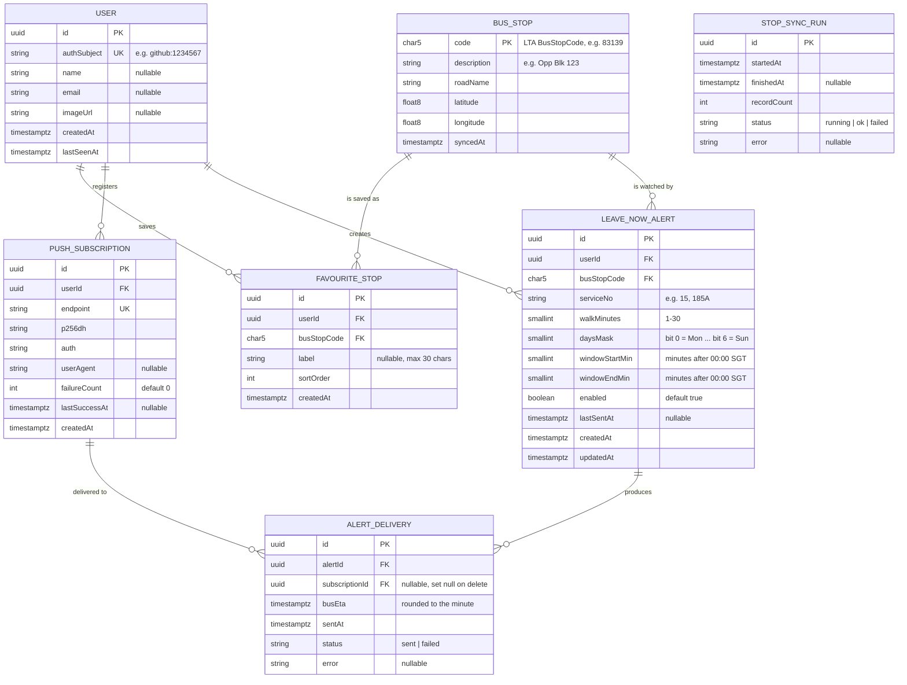

# Data model (ERD)

PostgreSQL on Neon, managed with Prisma (schema and migrations live in `apps/api/prisma`). Redis holds only cache data and is not part of this model (see [ARCHITECTURE.md](ARCHITECTURE.md#3-cache-and-ttl-strategy)).

## Tables

### `User`
One row per signed-in person. Created by the API the first time it sees a valid API token (`sub` claim → `authSubject`), so the web app needs no database. `authSubject` is `<provider>:<provider user id>` so another provider (PRD US-17) can be added without a migration.
- Deleting a user cascades to favourites, subscriptions, alerts and deliveries (PRD US-07 "delete my data").

### `BusStop`
A copy of LTA's `BusStops` dataset, refreshed weekly by `POST /internal/stops/sync`. Kept in Postgres so the API can boot without LTA and so foreign keys protect favourites and alerts from typos.
- If LTA removes a stop, the sync marks it by leaving `syncedAt` old rather than deleting it, so users' favourites are not lost; the UI shows "This stop is no longer in service".
- Index on `(latitude, longitude)` is not needed: nearby search runs on the API's in-memory index.

### `FavouriteStop`
- Unique `(userId, busStopCode)`: a stop can be saved once per user.
- `sortOrder` is set by the reorder endpoint; ties broken by `createdAt`.
- Application rule: max 20 rows per user (PRD US-08).

### `PushSubscription`
A browser's Web Push subscription (one per device/browser). `endpoint` is unique across all users; re-subscribing the same browser updates the row.
- Deleted on a 404/410 from the push service, or after 3 consecutive failures (`failureCount`).
- `p256dh` and `auth` are not passwords but are treated as sensitive: never logged.

### `LeaveNowAlert`
- Times are stored as minutes after midnight **Singapore time** (`Asia/Singapore`, UTC+8, no daylight saving), so `07:30` is `450`.
- Checks: `walkMinutes BETWEEN 1 AND 30`, `windowEndMin > windowStartMin`, `windowEndMin - windowStartMin <= 120`, `daysMask BETWEEN 1 AND 127`.
- Application rule: max 5 alerts per user (PRD US-11).
- Index on `(enabled)` for the tick query; the table is small enough that the API filters days and windows in memory.

### `AlertDelivery`
One row per notification attempt. Used for idempotency and debugging.
- Unique `(alertId, busEta)`: the same bus can never trigger two notifications, even if two ticks overlap.
- Rows older than 30 days are deleted by the tick job to keep storage small.

### `StopSyncRun`
Audit log of bus stop syncs, shown in `/health` as `stopsSyncedAt`.

## Story → table map

| Story | Tables |
| --- | --- |
| US-01 Search, US-02–05 Arrivals | `BusStop` (via in-memory index); no user tables |
| US-07 Sign in | `User` |
| US-08 Favourites | `FavouriteStop`, `BusStop` |
| US-09 Nearby | `BusStop` (via in-memory index) |
| US-11 Create alert | `LeaveNowAlert`, `PushSubscription` |
| US-12 Receive alert | `LeaveNowAlert`, `PushSubscription`, `AlertDelivery` |
| US-13 Manage alerts | `LeaveNowAlert` |

## Size estimate

| Table | Rows (v1, generous) | Approx. size |
| --- | --- | --- |
| BusStop | ~5,000 | < 2 MB |
| User | 500 | < 1 MB |
| FavouriteStop | 5,000 | < 2 MB |
| PushSubscription | 1,000 | < 1 MB |
| LeaveNowAlert | 2,500 | < 1 MB |
| AlertDelivery (30 days) | ~150,000 | ~30 MB |

Well under Neon Free's 1 GB per project.
